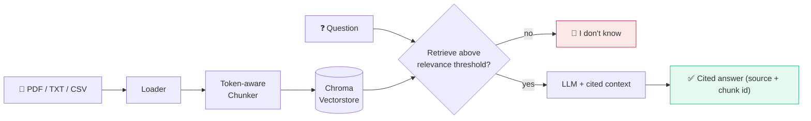
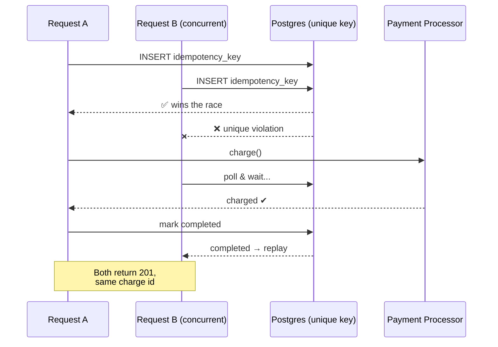
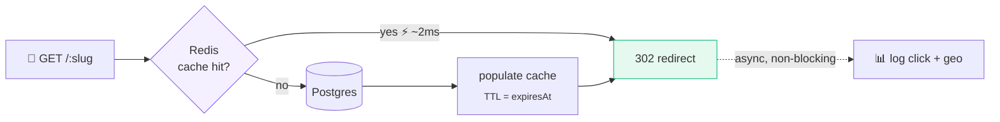
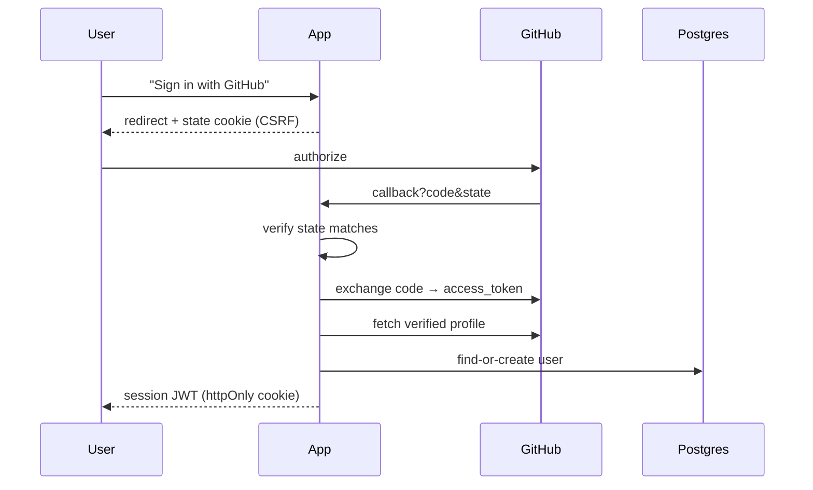
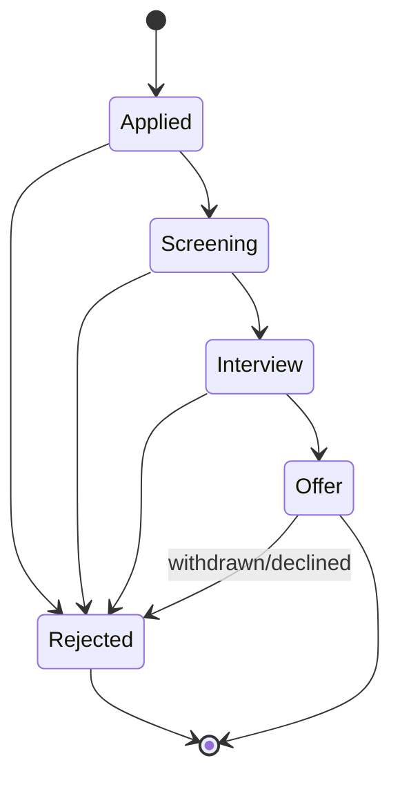

##  RAG Chatbot


Upload PDFs/TXT/CSV, ask questions, get answers that **cite the exact
chunk** they came from — or an honest "I don't know" instead of a guess.



**Why it earns a resume line:** RAG is *the* in-demand applied-AI skill
right now, and every interviewer has seen the shallow version. This one
has real answers ready for "why token-based chunking, not characters?" and
"how do you know retrieval quality is any good?" — backed by an eval
script that actually measures hit-rate and answer accuracy, not a vibe.

## Payment Gateway


Fire the same charge request 10 times **simultaneously**. Exactly one
charge happens. Everyone gets the identical response back.



**Why it earns a resume line:** the only pure-backend, non-AI project
here — proof you're more than "did some AI stuff." Idempotency keys and
race-safe writes are a real interview topic at any company touching
payments or webhooks, and this one is *load-tested*: 20 concurrent calls
in, exactly 1 charge out, verified against a real Postgres instance.


## URL Shortener


Short links with click analytics, QR codes, expiration, and rate limiting
— the classic "design a URL shortener" interview question, actually built
and load-tested.



**Why it earns a resume line:** maps almost exactly onto a real system-
design interview question, so you've *built and measured* the thing
people usually only whiteboard. Proof, not claims: **1.9ms** average
cache-hit redirect latency measured live, and 30 concurrent link-creation
requests against a limit of 10 letting through *exactly* 10 — the number
that proves the rate limiter's atomicity, not just "usually correct."

## Job Application Tracker


Applications move through a real, validated status pipeline with
background email reminders — behind real auth: email/password **and**
"Sign in with GitHub," both built from the actual protocol.





**Why it earns a resume line:** the least flashy idea, the most real
software. The only project here with an OAuth2 flow built step-by-step
against GitHub's actual API (not a library configured to do it
invisibly), a real background job queue for scheduled reminders, and two
independently-tested access-control layers — ownership checks *and* a
role-gated admin view, including a test proving one user genuinely cannot
edit another user's data. The status pipeline is a real state machine with
a full audit trail, which is also what makes its funnel analytics correct.

---

## 🚀 Running any project

```bash
cd projects/0N-project-name

# Python projects
python3 -m venv .venv && source .venv/bin/activate && pip install -r requirements-dev.txt
# Node projects
npm install

cp .env.example .env   # fill in whatever credentials that project needs
pytest   # or: npm test
```

Projects using Postgres/Redis (**2**, **6**, **7**) ship a
`docker-compose.yml` — `docker compose up -d` and you have a working
database with nothing installed locally.

## 📄 License

MIT — see [LICENSE](LICENSE).
